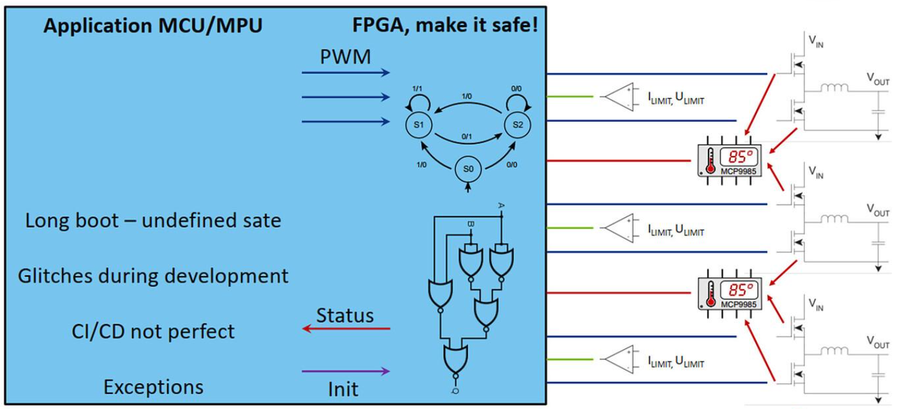

## ⚡ POWERCORE-X — FPGA Power Electronics Controller

  

  <strong>Intelligent Switching • Dead-Time Insertion • Fault Protection</strong>

 

 

  

ADVANCED DIGITAL SYSTEMS ENGINEERING

Programmable Power Converter Gate-Signal Controller

 

 

  

ONE FPGA. PRECISE TIMING. INTELLIGENT POWER CONTROL.

Designing deterministic switching architectures with configurable timing, dead-time management, and safety-oriented digital logic.

 

<a href="#-project-overview">PROJECT OVERVIEW</a>
  ◆  
<a href="#-system-architecture">ARCHITECTURE</a>
  ◆  
<a href="#-digital-control-engine">CONTROL ENGINE</a>
  ◆  
<a href="#-verification">VERIFICATION</a>
  ◆  
<a href="#-getting-started">GET STARTED</a>

  

◈ THE ENGINEERING CONCEPT

<!-- ═══════════════════════════════════════════════════════════════ -->
<!--                    PROJECT SPECIFICATION                       -->
<!-- ═══════════════════════════════════════════════════════════════ -->

<h2 align="center">
  ⚙️ PROJECT SPECIFICATION
</h2>

  <b>FPGA-Based Embedded Digital Control System</b>

  
  
  

---

<table align="center">
  <thead>
    <tr>
      <th align="left">🔧 SPECIFICATION</th>
      <th align="left">⚡ SELECTION</th>
    </tr>
  </thead>
  <tbody>
    <tr>
      <td><b>Project Type</b></td>
      <td>FPGA / Embedded Digital Control</td>
    </tr>
    <tr>
      <td><b>Hardware Platform</b></td>
      <td>Altera / Terasic DE2</td>
    </tr>
    <tr>
      <td><b>Programming Language</b></td>
      <td>VHDL-2008</td>
    </tr>
    <tr>
      <td><b>Main Clock Frequency</b></td>
      <td>50 MHz</td>
    </tr>
    <tr>
      <td><b>FPGA Development Software</b></td>
      <td>Intel Quartus</td>
    </tr>
    <tr>
      <td><b>Simulation Tools</b></td>
      <td>ModelSim / GHDL</td>
    </tr>
    <tr>
      <td><b>Waveform Viewer</b></td>
      <td>GTKWave</td>
    </tr>
    <tr>
      <td><b>Control Architecture</b></td>
      <td>Moore Finite State Machine (FSM)</td>
    </tr>
    <tr>
      <td><b>Advanced Safety Features</b></td>
      <td>Dead-Time Insertion / Fault Latching</td>
    </tr>
  </tbody>
</table>

---

  <b>DESIGNED FOR RELIABLE • DETERMINISTIC • SAFE DIGITAL CONTROL</b>

  <code>FPGA</code> ⚡ <code>VHDL</code> ⚡ <code>FSM</code> ⚡ <code>SAFETY LOGIC</code>

<!-- ═══════════════════════════════════════════════════════════════ -->
<!--                 END OF PROJECT SPECIFICATION                   -->
<!-- ═══════════════════════════════════════════════════════════════ -->

<!-- ═══════════════════════════════════════════════════════════════ -->
<!--                         PROJECT OVERVIEW                       -->
<!-- ═══════════════════════════════════════════════════════════════ -->

<h1 align="center">
  ⚡ 01 — PROJECT OVERVIEW
</h1>

<h3 align="center">
  POWERCORE-X | FPGA-BASED DIGITAL SWITCHING CONTROLLER
</h3>

  
  
  

---

### 🔴 1.1 System Description

**POWERCORE-X** is an FPGA-based digital controller developed using **VHDL-2008**. Its primary function is to generate two mutually exclusive switching-control signals, identified as `Sig1` and `Sig2`.

The controller operates through a deterministic four-state sequencing architecture. Each state defines a specific output configuration and remains active for a precisely defined time interval before transitioning to the next state.

The design is structured around a **Moore Finite State Machine (FSM)**, where the output signals depend exclusively on the current state. This architecture provides predictable timing behavior, organized control logic, and a clear separation between state transitions and output generation.

The project establishes a baseline waveform generator and then investigates additional digital-control enhancements, particularly dead-time insertion and fault-latching mechanisms.

---

### 🟠 1.2 Reference Operating Sequence

The baseline design follows the four-state waveform-generator exercise provided in the **Adventus Digital Systems laboratory material**.

The original timing sequence is preserved as the reference implementation:

<table align="center">
  <thead>
    <tr>
      <th align="center">STATE</th>
      <th align="center">DURATION</th>
      <th align="center">Sig1</th>
      <th align="center">Sig2</th>
    </tr>
  </thead>
  <tbody>
    <tr>
      <td align="center"><b>S0</b></td>
      <td align="center">10 µs</td>
      <td align="center"><b>🟢 HIGH</b></td>
      <td align="center">LOW</td>
    </tr>
    <tr>
      <td align="center"><b>S1</b></td>
      <td align="center">30 µs</td>
      <td align="center">LOW</td>
      <td align="center"><b>🟢 HIGH</b></td>
    </tr>
    <tr>
      <td align="center"><b>S2</b></td>
      <td align="center">10 µs</td>
      <td align="center"><b>🟢 HIGH</b></td>
      <td align="center">LOW</td>
    </tr>
    <tr>
      <td align="center"><b>S3</b></td>
      <td align="center">50 µs</td>
      <td align="center">LOW</td>
      <td align="center"><b>🟢 HIGH</b></td>
    </tr>
  </tbody>
</table>

  <b>COMPLETE SEQUENCE PERIOD = 100 µs</b>

The controller continuously repeats the sequence in the following order:

  <code>S0</code> → <code>S1</code> → <code>S2</code> → <code>S3</code> → <code>S0</code>

---

### 🟣 1.3 Timing Distribution

The total operating period is determined by the sum of the four state durations:

$$
T_{\text{period}} = T_{S0}+T_{S1}+T_{S2}+T_{S3}
$$

Substituting the reference timing values:

$$
T_{\text{period}} = 10+30+10+50
$$

Therefore, the complete sequence period is:

$$
\boxed{T_{\text{period}}=100\ \mu s}
$$

The corresponding repetition frequency is:

$$
f=\frac{1}{T_{\text{period}}}
$$

$$
\boxed{f=10\text{ kHz}}
$$

The individual state durations represent the following percentages of the complete cycle:

| State | Duration | Percentage |
|:---:|---:|---:|
| S0 | 10 µs | 10% |
| S1 | 30 µs | 30% |
| S2 | 10 µs | 10% |
| S3 | 50 µs | 50% |
| **Total** | **100 µs** | **100%** |

---

### 🔵 1.4 Baseline Design and Research Extensions

An important distinction is maintained between the original laboratory sequence and the additional features investigated in POWERCORE-X.

**Baseline Design**

- Four-state Moore FSM.
- Two mutually exclusive control outputs.
- Original state durations preserved.
- Continuous 100 µs repeating sequence.
- No inserted dead-time between switching states.

**Enhanced Design — Research Extensions**

- Dead-time insertion between switching transitions.
- Fault detection and fault-latching logic.
- Additional safety-oriented control behavior.
- Extended simulation and verification scenarios.

<blockquote>
  <b>⚠️ Engineering Note — Baseline vs. Enhanced Architecture</b>

  The original reference sequence does not include dead-time. Dead-time is an additional feature introduced in the enhanced design and must not be represented as part of the original laboratory implementation.
</blockquote>

---

### 🔴 1.5 Verification and Experimental Scope

The reference laboratory report describes RTL simulation of the waveform generator. However, it does not establish that the complete FPGA hardware implementation was successfully tested.

Therefore, POWERCORE-X treats hardware validation as a separate engineering responsibility.

The verification process should include:

1. RTL functional simulation of all four states.
2. Verification of the 10 µs, 30 µs, 10 µs, and 50 µs timing intervals.
3. Confirmation of the complete 100 µs repetition period.
4. Verification that `Sig1` and `Sig2` are never simultaneously HIGH.
5. Simulation of the enhanced dead-time behavior.
6. Testing of fault detection and fault-latching behavior.
7. FPGA implementation and physical validation on the target DE2 board.

Actual hardware validation results should only be reported after performing the corresponding tests.

---

  
  
  

  <b>POWERCORE-X</b> 
  <i>Deterministic Switching • FPGA Architecture • Safety-Oriented Digital Control</i>

---

<!-- ═══════════════════════════════════════════════════════════════ -->
<!--                 END OF PROJECT OVERVIEW                         -->
<!-- ═══════════════════════════════════════════════════════════════ -->

<!-- ═══════════════════════════════════════════════════════════════ -->
<!--                       02 — PROBLEM STATEMENT                   -->
<!-- ═══════════════════════════════════════════════════════════════ -->

<h1 align="center">
  ⚡ 02 — PROBLEM STATEMENT
</h1>

<h3 align="center">
  ENGINEERING CHALLENGE & PROPOSED DIGITAL CONTROL SOLUTION
</h3>

  
  
  

---

### 🔴 2.1 Engineering Problem

Digital switching systems require precisely timed control signals to coordinate switching operations. The accuracy, synchronization, and sequencing of these signals are essential to achieving predictable system behavior.

Incorrect timing intervals, overlapping control signals, or uncontrolled state transitions may introduce undesirable operating conditions and compromise the reliability of digital switching systems.

In conventional software-based control architectures, execution-time variability may arise from processor loading, interrupt handling, and software scheduling. These factors can complicate the implementation of highly deterministic timing requirements.

A **Field-Programmable Gate Array (FPGA)** provides a hardware-based alternative by allowing the control sequence to be implemented directly as synchronous digital logic.

POWERCORE-X addresses this engineering challenge through the development of a programmable FPGA-based digital controller designed to:

- Generate a predefined multi-phase switching sequence.
- Maintain digital mutual exclusion between `Sig1` and `Sig2`.
- Provide deterministic state transitions using synchronous control logic.
- Introduce configurable transition dead-time in the enhanced architecture.
- Establish a structured foundation for additional protection-oriented features.

The central engineering objective is to achieve precise, predictable, and controlled switching behavior through a dedicated digital hardware architecture.

---

### 🟠 2.2 Proposed Solution

The proposed solution is based on a **synchronous Moore Finite State Machine (FSM)** implemented using **VHDL-2008** and targeted at the Altera/Terasic DE2 FPGA platform.

A counter-based timing mechanism controls the duration of each operating phase. The FSM determines the active operating state, while the timing logic manages the transitions between successive phases.

The enhanced architecture extends the original controller by introducing additional digital control mechanisms, including:

- **Dead-Time Insertion:** Provides a configurable interval during which both switching-control outputs remain LOW during designated transitions.
- **Enable Control:** Provides a mechanism for controlling whether the switching sequence is permitted to operate.
- **Fault Latching:** Retains a detected fault condition until the defined reset or recovery procedure is applied.

The overall development is organized into two independently verifiable implementations.

<b>🔹 IMPLEMENTATION 01 — REFERENCE CONTROLLER</b>

 

The Reference Controller reproduces the original four-state timing sequence established in the laboratory exercise.

Its primary characteristics include:

- Four-state Moore FSM architecture.
- Counter-based state-duration control.
- Original 10 µs, 30 µs, 10 µs, and 50 µs timing intervals.
- Two mutually exclusive digital outputs.
- Continuous cyclic operation with a 100 µs reference period.

This implementation serves as the functional baseline for subsequent development and verification.

<b>🔸 IMPLEMENTATION 02 — ENHANCED CONTROLLER</b>

 

The Enhanced Controller extends the reference architecture with additional digital control and protection-oriented functionality.

Its development focuses on:

- Configurable dead-time intervals.
- Enable and controlled operating behavior.
- Fault detection and fault-latching mechanisms.
- Improved transition management.
- Additional simulation and verification scenarios.

This implementation represents the extended research-oriented version of POWERCORE-X.

---

### 🟣 2.3 Dual-Implementation Development Strategy

The separation between the reference and enhanced implementations establishes a clear verification methodology.

Rather than modifying the original timing behavior without distinction, the project preserves the baseline controller and evaluates the additional functionality as a separate design extension.

<table align="center">
  <thead>
    <tr>
      <th align="center">DESIGN ASPECT</th>
      <th align="center">REFERENCE</th>
      <th align="center">ENHANCED</th>
    </tr>
  </thead>
  <tbody>
    <tr>
      <td>Four-State FSM</td>
      <td align="center">✓</td>
      <td align="center">✓</td>
    </tr>
    <tr>
      <td>Original Timing Sequence</td>
      <td align="center">✓</td>
      <td align="center">Baseline-dependent</td>
    </tr>
    <tr>
      <td>Mutual Exclusion</td>
      <td align="center">✓</td>
      <td align="center">✓</td>
    </tr>
    <tr>
      <td>Dead-Time Insertion</td>
      <td align="center">—</td>
      <td align="center">✓</td>
    </tr>
    <tr>
      <td>Enable Control</td>
      <td align="center">—</td>
      <td align="center">✓</td>
    </tr>
    <tr>
      <td>Fault Latching</td>
      <td align="center">—</td>
      <td align="center">✓</td>
    </tr>
  </tbody>
</table>

---

  <b>FROM TIMING-BASED DIGITAL LOGIC TO SAFETY-ORIENTED FPGA CONTROL</b>

  <code>DETERMINISTIC TIMING</code>
  &nbsp;◆&nbsp;
  <code>MUTUAL EXCLUSION</code>
  &nbsp;◆&nbsp;
  <code>DEAD-TIME</code>
  &nbsp;◆&nbsp;
  <code>FAULT MANAGEMENT</code>

<h3 align="center">
  POWERCORE-X | ENGINEERING DESIGN & DEVELOPMENT
</h3>

<!-- ═══════════════════════════════════════════════════════════════ -->
<!--                    END OF SECTION 02                           -->
<!-- ═══════════════════════════════════════════════════════════════ -->

03 — PROJECT OBJECTIVES
The main objectives of POWERCORE-X are:
1. Develop a deterministic FPGA-based digital controller.
2. Reproduce the original four-state waveform sequence.
3. Implement accurate timing using a 50 MHz system clock.
4. Design a Moore FSM using VHDL-2008.
5. Guarantee digital mutual exclusion between Sig1 and Sig2.
6. Introduce configurable dead-time between switching phases.
7. Implement enable and disable functionality.
8. Develop a latched fault mechanism.
9. Verify the design through self-checking VHDL testbenches.
10. Evaluate the design through FPGA synthesis and hardware testing.
11. Compare the reference and enhanced architectures.
12. Establish a foundation for more advanced FPGA-based power-control research.
3.1 Research Questions
The project investigates the following questions:
- Can a synchronous Moore FSM reproduce the required switching sequence with deterministic timing?
- How can dead-time be inserted without generating overlapping output signals?
- How can a fault condition force the controller into a non-switching state?
- What is the impact of the enhanced architecture on FPGA resource utilization?
- How closely do simulated timing results correspond to physical FPGA measurements?

04 — SYSTEM ARCHITECTURE
4.1 High-Level Architecture
The system consists of the following functional blocks:
1. Clock and reset interface.
2. Timing counter.
3. Finite State Machine.
4. Moore output decoder.
5. Dead-time generator.
6. Fault-latching mechanism.
7. Output safety gating.
8. FPGA input/output interface.
4.2 Functional Block Diagram
